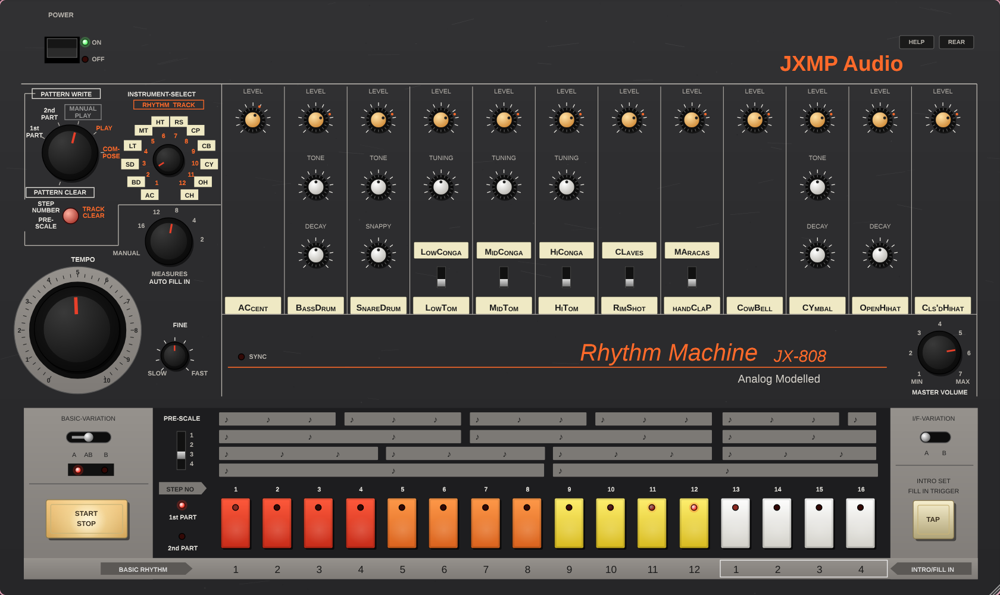
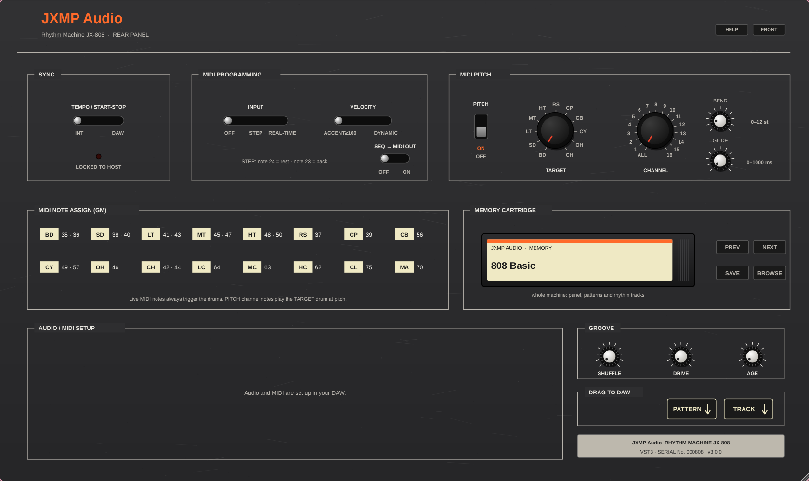
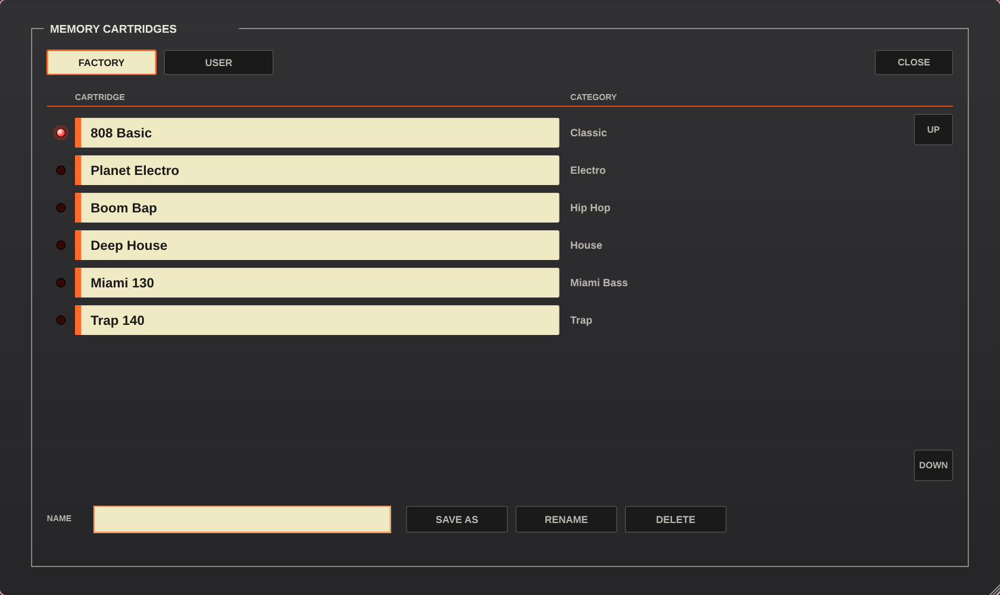

# JX-808 Rhythm Machine (JX808)

An analogue-modelled drum machine by **JXMP Audio**, as a VST3 plugin and a standalone app for
Windows and Linux. It is built with [HISE](https://github.com/christophhart/HISE).

The sound engine models classic analogue drum voices (bridged-T resonators, square-wave metal banks,
filtered noise) and a vintage drum-machine CPU section (tempo clock, step sequencer, common trigger
and accent). The interface looks and works like a hardware unit of that era: knobs, rotary selectors,
slide switches and 16 coloured step keys, with no menus. Everything a vintage unit wouldn't have lives
on the **rear panel**: DAW sync, MIDI, groove, presets and MIDI export/import.

> JX808 is an original JXMP Audio product. It contains no third-party trademarks, logos, samples or
> documents and is not affiliated with, endorsed by or derived from any other manufacturer.



| Rear panel | Cartridge browser |
|---|---|
|  |  |

More in [`docs/screenshots/`](docs/screenshots/) (1680 × 1000, the window at 131 %).

## Contents

- [Features](#features)
- [Installation](#installation)
- [Quick start](#quick-start)
- [How the machine works](#how-the-machine-works)
- [Front panel](#front-panel)
- [Rear panel](#rear-panel)
- [Workflows](#workflows)
- [MIDI](#midi)
- [DAW integration](#daw-integration)
- [Troubleshooting](#troubleshooting)
- [Building from source](#building-from-source)
- [Changes](#changes)
- [Credits and licences](#credits-and-licences)

## Features

**The machine**
- 11 analogue-modelled voices: bass drum, snare, low/mid/high tom or conga, rim shot or claves,
  hand clap or maracas, cowbell, cymbal, open and closed hihat (the closed hihat chokes the open one).
- Accent with classic trigger voltages (4 V, or 4–14 V when accented).
- The sequencer: 16 rhythms with A/B variations, a 1st and an optional 2nd part of up to 16 steps,
  12 rhythm tracks of up to 64 measures, intro and fill-in rhythms, auto fill-in every N measures,
  four PRE-SCALE step lengths (8th triplet, 16th triplet, 16th, 32nd), TAP and step programming.
- Tempo 40–300 BPM on a 24 PPQN clock.

**Additions (rear panel, key combinations, MIDI)**
- **DAW sync:** tempo, start/stop and song position follow the host, sample-accurate, including
  count-in, loops and locate.
- **MIDI drum programming:** write patterns from a keyboard or pads, as step input or in real time.
- **MIDI pitch mode:** play one drum chromatically, e.g. the bass drum as an 808 bass with glide and bend.
- **Sequencer MIDI out:** the sequencer can also send its hits as MIDI notes to the DAW.
- **Drag & drop MIDI:** drag a rhythm or a composed rhythm track into the DAW as a MIDI clip, or drop
  a clip on the machine to import it.
- **Groove and character:** SHUFFLE (50–75 %), DRIVE (output saturation) and AGE (a worn unit's timing
  and level spread).
- **Output stage:** a hot output (an accented bass drum peaks near −1 dBFS at full volume) with a soft
  limiter, so hits that land together never clip.
- **Voice mutes:** click a voice name to mute it.
- **Copy, paste and undo** with key combinations, so nothing new is printed on the panel.
- **Memory cartridge:** presets of the whole machine (sound, patterns, rhythm tracks) with its own
  cartridge browser, plus 6 factory presets (Classic, Electro, Hip Hop, Trap, House, Miami Bass).
- **DAW automation** of all sound and tempo knobs.
- **Resizable window:** drag the corner and the panel scales. A ZOOM setting is in the standalone app.
- **HELP bar:** hover a control to see what it does.

## Installation

Download the zips from the **Releases** page of this repository.

| File | What | Where it goes |
|---|---|---|
| `JX808-<version>-windows-x64-vst3.zip` | VST3 plugin (one file `JX808.vst3`) | `C:\Program Files\Common Files\VST3\` |
| `JX808-<version>-windows-x64-standalone.zip` | standalone app `JX808.exe` | anywhere |
| `JX808-<version>-linux-x64-vst3.zip` | VST3 plugin (folder `JX808.vst3`) | `~/.vst3/` (or `/usr/lib/vst3/`) |
| `JX808-<version>-linux-x64-standalone.zip` | standalone app `JX808` | anywhere (`chmod +x JX808`) |

**Requirements:**
- Windows 10/11 x64.
- Linux x64 with glibc 2.35 or newer (Ubuntu 22.04, Fedora 36, Debian 12 or newer), plus ALSA and
  X11/XWayland libraries. JACK and PipeWire work through ALSA or JACK.

**Windows:** right-click the downloaded zip → *Properties* → tick **Unblock** before you extract it.
Otherwise some hosts silently ignore the plugin. If the host reports a missing `MSVCP140.dll`, install
the *Microsoft Visual C++ Redistributable (x64)*.

**Then in your DAW:** rescan the plugins (Cubase: *Studio → VST Plug-in Manager*; Ardour: *Window →
Plugin Manager → Re-scan*) and add **JX808** by **JXMP Audio** on an instrument / MIDI track.

## Quick start

1. Open JX808 and press **START/STOP**. Rhythm 1 plays (the demo, or the loaded factory preset).
2. Press step keys **1–12** to switch rhythms, and turn the voice knobs.
3. Flip the machine with **REAR** (top right). Browse the factory presets on the **MEMORY CARTRIDGE**
   with NEXT / PREV. Switch **SYNC** to **DAW** and the machine follows your DAW's transport.
4. Press **HELP** whenever you want to know what a control does.

In the standalone app, first pick the audio device and the MIDI inputs on the rear panel under
**AUDIO / MIDI SETUP**.

## How the machine works

- **Rhythms 1–16**, each with two variations **A** and **B**. Rhythms 1–12 are the basic rhythms.
  Rhythms 13–16 are the four intro / fill-in rhythms (step keys 13–16, printed "INTRO/FILL IN 1–4").
- Every variation has a **1st part** of 1–16 steps and an optional **2nd part** of 1–16 steps. With a
  2nd part a measure is up to 32 steps long.
- **12 instrument rows** per part: AC (accent), BD, SD, LT, MT, HT, RS, CP, CB, CY, OH, CH. An accented
  step plays every instrument on it louder.
- **BASIC-VARIATION** plays A, B, or A and B in turn (AB). The fill uses **I/F-VARIATION**.
- **Rhythm tracks 1–12** are songs: chains of up to 64 measures, each one a rhythm variation.
- **MODE** selects what the step keys do: write patterns (1st / 2nd PART), clear (PATTERN CLEAR), play
  rhythms (MANUAL PLAY), play a rhythm track (PLAY) or build one (COMPOSE).

Everything (panel, pattern memory, rhythm tracks) is saved with the DAW project and in presets.

## Front panel

| Control | Function |
|---|---|
| POWER | ON lights green and runs a short self-test: a light sweeps over the step keys. OFF stops the sequencer, mutes the output and turns off all LEDs; only the red OFF lamp stays lit (standby). The plugin always opens ON |
| MODE (selector) | PATTERN CLEAR · 1st PART · 2nd PART (pattern write) · MANUAL PLAY · PLAY (rhythm track) · COMPOSE |
| INSTRUMENT-SELECT (selector) | Write modes: the instrument being written (AC, BD … CH). PLAY / COMPOSE: the rhythm track 1–12 (red legend) |
| CLEAR (red, TRACK CLEAR) | Press: PATTERN CLEAR clears the selected rhythm's variation (B when BASIC-VARIATION = B, else A), write modes clear the instrument's row, COMPOSE clears the track. **Hold CLEAR + step key** in a write mode sets the last step of the part. **Right click** holds it (see below) |
| AUTO FILL IN (selector) | MANUAL, 16, 12, 8, 4, 2: plays the fill rhythm every N measures (MANUAL = only with TAP) |
| TEMPO + FINE | 40–300 BPM plus fine ±4 BPM (ignored while SYNC = DAW) |
| Voice knobs and switches | ACCENT; BD level/tone/decay; SD level/tone/snappy; LT, MT, HT level/tuning with LC/MC/HC switches; RS/CL and CP/MA level with switches; CB level; CY level/tone/decay; OH level/decay; CH level |
| Voice names (cream labels) | Click a voice name to mute / unmute that voice (shown as MUTE) |
| MASTER VOLUME | Output level. At full volume an accented BD peaks near −1 dBFS; a soft limiter keeps hits that land together under 0 dBFS |
| SYNC LED | Lit while the rear SYNC switch is on DAW |
| BASIC-VARIATION | A / AB / B. In write modes A or B picks the variation you edit. The LEDs show the variation that's playing |
| PRE-SCALE | 1 = 8th triplet, 2 = 16th triplet, 3 = 16th, 4 = 32nd (step length) |
| 1st PART / 2nd PART LEDs | Part that's playing (or being edited) |
| Step keys 1–16 | Write modes: toggle steps; the LEDs show the pattern and a chaser light. MANUAL PLAY / PATTERN CLEAR / COMPOSE: keys 1–12 select the basic rhythm, keys 13–16 the intro/fill rhythm 1–4 |
| START/STOP | Starts and stops the sequencer (ignored while SYNC = DAW). A bulb under the key lights it while the sequencer runs, also when the DAW runs it |
| TAP | Write modes: writes the instrument at the playing step. COMPOSE: appends the selected rhythm to the track. MANUAL PLAY / PLAY: INTRO SET / FILL IN TRIGGER (stopped: the next start plays an intro; playing: a fill at the next measure) |
| I/F-VARIATION | Variation used for intro / fill-in |
| REAR | Turns the machine around (**FRONT** turns it back) |
| HELP | Help bar at the bottom: hover a control to see what it does |

**Knobs:** drag up / down, **Shift** (or Ctrl) + drag for fine steps, mouse wheel, **double click** for the
default value, **Alt + click** to type a value.

**Key combinations** (not printed on the panel). A mouse can't hold two keys, so **right-click CLEAR or
TAP to hold it**: the key stays down and a small bulb under it blinks like an old indicator lamp until
your next click on a step key, CLEAR or TAP, then lets
go. Right-click it again (or left-click it) to let go without doing anything.

| Combination | Mode | Does |
|---|---|---|
| hold CLEAR + step key (right-click CLEAR, then the key) | 1st / 2nd PART | last step of the part = that key |
| hold TAP + step key (right-click TAP, then the key) | PATTERN CLEAR | copy the selected rhythm (A and B) to that rhythm |
| hold TAP + CLEAR (right-click TAP, then CLEAR) | 1st / 2nd PART | copy the variation you edit into the other one (A → B or B → A) |
| hold CLEAR + TAP (right-click CLEAR, then TAP) | any | undo the last change of the pattern or track memory |

## Rear panel

| Section | Control | Values |
|---|---|---|
| SYNC | slide switch + LED | INT: own tempo. DAW: tempo, start/stop and the song position follow the host. Starting mid-song, looping or locating lands on the right step and bar (16th steps line up with the DAW grid) |
| MIDI PROGRAMMING | INPUT | OFF · STEP · REAL-TIME |
| | VELOCITY | ACCENT ≥100 · DYNAMIC |
| | SEQ → MIDI OUT | OFF · ON: the sequencer also sends its hits as MIDI notes |
| MIDI PITCH | PITCH lever | ON / OFF |
| | TARGET (selector) | BD, SD, LT, MT, HT, RS, CP, CB, CY, OH, CH |
| | CHANNEL (selector) | ALL, 1–16 |
| | BEND, GLIDE | 0–12 semitones, 0–1000 ms |
| MIDI NOTE ASSIGN | printed | GM note map (see [MIDI](#midi)) |
| MEMORY CARTRIDGE | PREV, NEXT, SAVE, BROWSE | Presets of the whole machine. SAVE stores the next free `User/JX-808 nnn`. BROWSE opens the cartridge browser |
| GROOVE | SHUFFLE, DRIVE, AGE | SHUFFLE 50–75 %: delays every 2nd step of a pair (50 % straight, 66.7 % triplet feel). DRIVE: output saturation. AGE: hits up to 4 ms late and ±15 % in level |
| DRAG TO DAW | PATTERN, TRACK | Drag a tile into the DAW. PATTERN: the selected rhythm. TRACK: the composed rhythm track (EMPTY when nothing is composed). Drop a MIDI clip on PATTERN to import it |
| AUDIO / MIDI SETUP | standalone only | audio driver, device, output, buffer size, sample rate, zoom 75–150 %, MIDI inputs |

## Workflows

### Program a pattern on the panel
1. **MODE → MANUAL PLAY**, press the step key of the rhythm you want to edit (1–12, or 13–16 for a fill).
2. **MODE → 1st PART**. Choose A or B with **BASIC-VARIATION**.
3. Turn **INSTRUMENT-SELECT** to an instrument and toggle its steps with the step keys. Start the
   sequencer to hear it. The chaser light shows the playing step.
4. Accents: select **AC** and set steps like for any instrument.
5. Shorter part: hold **CLEAR** (right click) and press the key of the last step.
6. A 2nd part (bars 17–32): **MODE → 2nd PART**. Programming a step creates it.
7. Clear a row: **CLEAR** in a write mode. Clear a rhythm: **MODE → PATTERN CLEAR**, select it, **CLEAR**
   (clears the variation set by BASIC-VARIATION: B when on B, else A).

You can also write while the sequencer runs: press **TAP** in time and the instrument goes onto the
playing step.

### Build a song (rhythm track)
1. **MODE → COMPOSE**, choose the track 1–12 with **INSTRUMENT-SELECT**.
2. Select a rhythm with the step keys (and A/B with BASIC-VARIATION) and press **TAP** to append it as
   the next measure. Repeat. **CLEAR** empties the track.
3. **MODE → PLAY** and **START/STOP** plays the track. It loops at the end.
4. To get the song into the DAW as MIDI, drag **TRACK** on the rear panel (see [MIDI](#midi)).

### Intro and fills
- In MANUAL PLAY, keys 13–16 select the fill rhythm and **I/F-VARIATION** its variation.
- **TAP** while stopped: the next start plays the intro. **TAP** while playing: the fill plays at the next measure.
- **AUTO FILL IN** plays the fill every 16, 12, 8, 4 or 2 measures by itself.

### Copy and undo
- Copy a rhythm: **MODE → PATTERN CLEAR**, select the source with its step key, then hold **TAP** (right click) and press the target key.
- Copy A ↔ B: in 1st / 2nd PART hold **TAP** (right click) and press **CLEAR**.
- Undo: hold **CLEAR** (right click) and press **TAP**. This reverses the last change of the memory (step, clear,
  copy, TAP write, MIDI write, MIDI import).

### Mute voices
Click a voice's cream name label (BassDrum, SnareDrum …). It shows **MUTE** and the voice is silent.
Click again to unmute. Mutes are saved with presets and projects.

### 808 bass (MIDI pitch mode)
On the rear panel turn **PITCH** on, set **TARGET = BD** and a **CHANNEL** (e.g. 2). Notes on that
channel now play the bass drum at their pitch (A1 = 55 Hz), with **GLIDE** for overlapping notes and
**BEND** for the pitch wheel. Turn up **BD DECAY** for long notes. Other channels still trigger drums,
so you can play drums on channel 1 and bass on channel 2. CY, OH and CH transpose relative to C3.
If the sequencer hits the target drum while no key is held, the drum returns to its panel tuning.

### Presets
- **NEXT / PREV** step through all presets, and the cartridge label shows the loaded one.
- **SAVE** stores the current machine as a new user preset `User/JX-808 001`, `002` …
- **BROWSE** opens the cartridge browser over the whole window:
  - The **FACTORY** and **USER** tabs switch banks. Click a cartridge to load it; the red LED marks the loaded one.
  - Type a name in **NAME**, then **SAVE AS** stores the machine under that name in USER.
  - **RENAME** renames the selected user cartridge to the typed name.
  - **DELETE** needs a second press (CONFIRM?).
  - Factory cartridges can't be renamed or deleted. **UP / DOWN** scroll long lists. **CLOSE** goes back.
- Factory presets are in the **Factory** bank: Classic, Electro, Hip Hop, Trap, House, Miami Bass.
  Each sets the sound, tempo, groove, rhythm 1A / 1B / fill 13A and rhythm track 1
  (1A 1A 1B 1B 1A 1A 1B 13A).

## MIDI

**Note map** (GM drums; any channel except the PITCH channel):

| Note | Voice | Note | Voice |
|---|---|---|---|
| 35, 36 | BD | 42, 44 | CH |
| 38, 40 | SD | 46 | OH |
| 41, 43 | LT | 49, 57 | CY |
| 45, 47 | MT | 56 | CB |
| 48, 50 | HT | 37 / 75 | RS / CL |
| 64 / 63 / 62 | LC / MC / HC | 39 / 70 | CP / MA |

Live notes always trigger the drums.
- **VELOCITY = ACCENT ≥100** works like a vintage unit: a hit is either normal (4 V) or accented (4–14 V, set
  by the ACCENT knob).
- **DYNAMIC** scales the trigger voltage with velocity instead.

**MIDI drum programming:** rear **MIDI PROGRAMMING INPUT** = STEP or REAL-TIME, front MODE = 1st or
2nd PART.
- **STEP** (sequencer stopped): every note is written at the cursor (the ringed LED), then the cursor
  moves on.
  - Notes played within 50 ms of each other are a chord on one step.
  - Note 24 is a rest and note 23 moves back one step.
  - Clicking a step key moves the cursor there.
- **REAL-TIME** (sequencer running): notes are quantized to the nearest step of the looping part.
- With VELOCITY = ACCENT ≥100, loud notes also write an accent.

**Sequencer MIDI out:** rear **SEQ → MIDI OUT = ON** sends every sequencer hit as a 50 ms note:
- GM notes on channel 10, accent 127, otherwise 90.
- Conga, claves and maracas use their own notes (64, 63, 62, 75, 70).
- Route the plugin's MIDI output to another instrument in your DAW to layer or replace sounds.
- Live MIDI input is not echoed.

**Drag & drop MIDI** (rear **DRAG TO DAW**):
- **PATTERN** drags the selected rhythm as a `.mid` file: variation A, B, or A then B, depending on
  BASIC-VARIATION. File name e.g. `JX808 Rhythm 3AB.mid`.
- **TRACK** drags the rhythm track chosen with INSTRUMENT-SELECT in PLAY / COMPOSE, measure by measure,
  exactly as composed in COMPOSE (see [Build a song](#build-a-song-rhythm-track)). It is not "everything
  in the machine": only the measures appended to that track. With nothing composed the tile shows
  **EMPTY** and doesn't drag.
- Both apply PRE-SCALE, SHUFFLE and the conga/claves/maracas switches. Accent = velocity 127, others 90.
- **Drop a MIDI clip on PATTERN** to import it into the selected rhythm: bar 1 → A, bar 2 → B, GM notes,
  velocity ≥100 = accent, quantized to the step grid. Undo with CLEAR + TAP.

## DAW integration

- **Sync:** rear **SYNC = DAW**. The node follows the host tempo, transport and PPQ position:
  - Starting in the middle of the song lands on the right step, measure, variation and track position.
  - A count-in (negative position) waits until bar 1.
  - Loops and locate realign at once.
  - Switching SYNC on while the host plays joins in time.
  - POWER OFF releases the sync.
- **Automation:** these knobs are plugin parameters:
  - Accent, Master Volume, Tempo, Tempo Fine, Shuffle, Drive, Age, Pitch Bend Range, Glide.
  - Every voice's Level, Tone, Tuning, Decay and Snappy.
  - Mode selectors, switches and keys are not automatable, because they change patterns and modes.
- **State:** the panel and the whole pattern / track memory are saved with the project.
- **Window size:** drag the bottom-right corner (or the window edge). The panel keeps its aspect ratio
  and scales from 50 % to 300 %, and the size is remembered. On tiling window managers (Hyprland, Sway,
  i3) the panel scales to the tile. For a floating window at the panel's size, add a float rule for
  the window class `JX808`.

## Troubleshooting

| Problem | Fix |
|---|---|
| Standalone app: no sound | Rear **AUDIO / MIDI SETUP**: pick the device. On Linux with PipeWire choose ALSA *pipewire* / *default* or the JACK driver. A raw hardware device may be busy |
| Standalone app: MIDI keyboard does nothing | Enable it under **MIDI INPUTS** on the rear panel |
| DAW doesn't list JX808 | Check the install folder (see [Installation](#installation)), unblock the zip on Windows, rescan. Cubase: look in the *Blocklist* of the Plug-in Manager and *Reactivate* |
| Plugin scan fails on Linux with `BadWindow … X_GetProperty` | Fixed in 2.5.0 (HISE patch 0004). Older versions crash on window managers without an XSETTINGS manager, e.g. Hyprland or Sway |
| TEMPO knob does nothing | SYNC is on DAW (SYNC LED lit), so the host tempo is used |
| START/STOP does nothing | SYNC = DAW (start the DAW transport) or POWER is off |
| "COMPILE THE C++ NODE" overlay | Only in the HISE editor without the node DLL, see [Building from source](#building-from-source) |
| Patterns gone after reopening a project | Fixed in 2.3.0 (HISE patch 0002). Before that, presets and projects didn't store the memory |
| Dragged TRACK plays something else than my patterns | TRACK is the rhythm track composed in COMPOSE, not your patterns. A new instance has a demo track (1A 1A 1B 13A). Compose your own, or drag PATTERN |
| TRACK tile shows EMPTY | The selected rhythm track has no measures: compose it first (MODE → COMPOSE, TAP) |
| A new instance played triplets / dragged MIDI had all notes at the start | Fixed in 2.6.1: the slide switches started at 0 instead of their defaults |
| Louder than before after updating | Since 2.7.0 the output is about 7 dB hotter. Turn MASTER VOLUME or the track fader down |

## Building from source

The project is a HISE project, and all releases are built with **HISE 4.1.0** plus a few patches
(`.github/hise-patches/`).

### Requirements
- Linux x64 (the build scripts are bash; Windows builds run in CI, see below).
- A C++17 toolchain (`g++`, `make`), `pkg-config`, `rsync`, `unzip`, `git`, `curl`.
- JUCE Linux dev packages: ALSA, FreeType, X11, Xinerama, Xext, Xrandr, Xcursor, OpenGL, GTK 3,
  JACK (optional, else the standalone uses ALSA only) and libcurl (optional).
  - Debian/Ubuntu: `sudo apt install build-essential pkg-config libasound2-dev libfreetype-dev libx11-dev libxinerama-dev libxext-dev libxrandr-dev libxcursor-dev libgl1-mesa-dev libgtk-3-dev libjack-jackd2-dev libcurl4-openssl-dev`
  - Fedora: `sudo dnf install gcc-c++ make alsa-lib-devel freetype-devel libX11-devel libXinerama-devel libXext-devel libXrandr-devel libXcursor-devel mesa-libGL-devel gtk3-devel pipewire-jack-audio-connection-kit-devel libcurl-devel`

### 1. HISE
```sh
git clone https://github.com/JXMP-Audio/JX808.git
./JX808/.github/hise-setup.sh   # ../HISE next to the checkout: 4.1.0 source + SDK + our patches, the HISE binary,
                                # and ~/.hise/compilerSettings.xml pointing at ../HISE/source
```
The HISE patches:

| Patch | Why |
|---|---|
| 0001 resizable-frontend | the plugin / standalone window resizes and scales |
| 0002 hardcoded-fx-state-after-set-effect | presets and DAW projects store the node state and pattern memory |
| 0003 midi-out-for-hardcoded-nodes | SEQ → MIDI OUT |
| 0004 juce-no-xsettings-manager | no host crash on window managers without XSETTINGS |

The HISE export reads the HISE path from its settings file (`~/.hise/compilerSettings.xml`, written by the setup
script), not from the command line.

### 2. Build
```sh
cd JX808
./build.sh standalone      # -> build/Standalone/Builds/LinuxMakefile/build/JX808
./build.sh vst3            # -> build/VST3/Builds/LinuxMakefile/build/JX808.vst3
./build.sh                 # both
```
`build.sh` exports with the HISE CLI, re-saves the project with Projucer and compiles with `make`.

HISE recreates its standard project folders (AudioFiles, Documentation, Expansions, MidiFiles,
Presets, SampleMaps, Samples), the export folder `Binaries/` and `PooledResources/` on every load or
export. They are empty or generated and are not in git; all builds go to `build/`. The
first build compiles all of HISE (about 15 min), later builds are incremental. Override the tools with
`HISE_BIN=… HISE_PATH=…`. Without the JACK headers the standalone is built with ALSA only.

### 3. Releases (GitHub Actions)
`.github/workflows/release.yml` builds the VST3 and the standalone app for Linux (Ubuntu 22.04) and
Windows (MSBuild), validates the VST3 with **pluginval** (strictness 5) and publishes a release.
Windows can't run the HISE export headless, so the Linux job exports the project once and the Windows
job only compiles that export. Our HISE patches are in `.github/hise-patches/`.

Workflows only run when started on purpose, to save Actions minutes:
- **Release:** push a tag matching `<Version>` in `project_info.xml` (`git tag v2.8.0 && git push origin v2.8.0`),
  or *Actions → Release → Run workflow*. Without *publish* it only builds and validates.

### Working in the HISE editor
1. **File → Load Project** → this folder, then **File → Open XML Backup** → `XmlPresetBackups/JX808.xml`.
   The interface script builds the module tree (`JX808 Engine` silent synth + `JX808 DSP` hardcoded FX)
   and loads the C++ node `JX808`.
2. To run the node inside the editor, HISE needs it as a DLL (`DspNetworks/Binaries`, generated, not in
   git). Without it the editor shows "COMPILE THE C++ NODE" and stays silent. Exports are not affected,
   because they compile the node in statically (`AdditionalSourceCode/nodes/`).
3. After changing `DspNetworks/ThirdParty/JX808.h` or `DspNetworks/ThirdParty/src/jx808_dsp.h`, rebuild the DLL, or simply
   rebuild with `build.sh`.

### Factory presets
`UserPresets/Factory/` is embedded into the plugin. Because of `HISE_OVERWRITE_OLD_USER_PRESETS`, a
new version re-extracts it for existing users. The files are generated from `Scripts/JX808/Factory.js`
by HISE itself:
1. Put an empty file `.generate-factory` into the user preset folder of the standalone app (Linux:
   `~/.config/JXMP Audio/JX808/User Presets/`).
2. Start the app once.
3. Copy `Factory/` from there into `UserPresets/`.

## Changes

| Version | Changes |
|---|---|
| 3.0.0 | Renamed to **JX808** (Rhythm Machine JX-808): new plugin identity (`JX808.vst3`, plugin code `Jxrm`) and user preset folder, module and node names `JX808`. No third-party trademarks in the panel, docs or repository |
| 2.10.0 | Knobs: Shift / Ctrl + drag fine-tunes, Alt + click types a value. LEDs glow like small bulbs (afterglow behind the chaser). POWER ON runs a self-test sweep over the step keys. The panel shows some wear: fine scratches, keys polished by fingers |
| 2.9.0 | START/STOP is lit by the same retro bulb while the sequencer runs (fades in on START, out on STOP) |
| 2.8.5 | The held key's lamp is a retro incandescent bulb: warm amber with a hot spot, on / off about once a second, warming up fast and cooling down slower |
| 2.8.4 | A held CLEAR / TAP lights up like a lamp under the plastic, pulsing slowly (1.2 s) instead of blinking. `build.sh` uses half the cores (`JOBS=…`) |
| 2.8.3 | A right-click-held CLEAR / TAP really shows: orange rim, blinking (2.8.2 only set the value, which the keys didn't draw) |
| 2.8.2 | FINE points straight up at 0 (HISE skewed the −4…+4 range). A right-click-held CLEAR / TAP blinks |
| 2.8.1 | Narrow buttons fit their text (DOWN in the cartridge browser) |
| 2.8.0 | Right click holds CLEAR / TAP, so the key combinations work with a mouse |
| 2.7.0 | Output about 7 dB louder with a soft limiter. Factory presets get rhythm track 1. TRACK shows EMPTY when nothing is composed |
| 2.6.1 | Slide switches start at their defaults (a new instance played 8th triplets). MIDI export uses the step length again; file names without ".0" |
| 2.6.0 | Own cartridge browser in the panel style (FACTORY / USER, SAVE AS, RENAME, DELETE) |
| 2.5.0 | No plugin scan crash on Hyprland / Sway (HISE patch 0004) |
| 2.3.0 | Presets and DAW projects store the pattern and track memory (HISE patch 0002) |
| 2.0.0 | Vendor JXMP Audio, new plugin identity |

## Credits and licences

- JX808 is free software: you can redistribute it and/or modify it under the terms of the GNU General Public
  License version 3 ([LICENSE](LICENSE)).
- Built with [HISE](https://github.com/christophhart/HISE) (GPL v3) and JUCE (GPL v3), with our changes to HISE
  in [`.github/hise-patches/`](.github/hise-patches/).
- "VST" is a trademark of Steinberg Media Technologies GmbH.
- Panel font: Liberation Sans, SIL Open Font License 1.1 (`Images/Fonts/LICENSE-LiberationSans.txt`).
- Circuit model: JXMP Audio, from publicly known analogue drum-voice topologies (bridged-T, VCA, noise).
